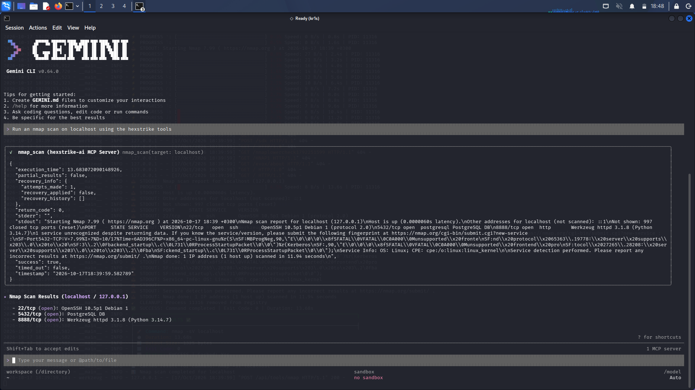

# AI Security Automation Agent (HexStrike + Gemini CLI/Ollama)

## 📖 Objective
To explore the frontier of **Agentic AI** in cybersecurity by integrating Large Language Models (LLMs) with offensive security tools. The goal is to automate the reconnaissance phase of penetration testing using natural language prompts.

## 🏗️ Architecture & Tools
This project utilizes a **Model Context Protocol (MCP)** server to bridge the gap between an AI agent and the local operating system.

- **AI Agent:** Gemini CLI (or Ollama for local LLM execution)
- **MCP Server:** HexStrike AI
- **Tools Automated:** Nmap (Network Mapper)
- **Environment:** Kali Linux

## 🔬 Methodology

### 1. The Setup
I configured the HexStrike AI MCP server to run locally. This acts as a bridge, giving the LLM the ability to execute terminal commands safely in a controlled environment.

### 2. The Natural Language Prompt
Instead of manually typing complex Nmap flags, I provided the AI agent with a simple, natural language instruction:
> `"Run an nmap scan on localhost using the hexstrike tools"`

### 3. Autonomous Execution
The AI agent processed the prompt, communicated with the HexStrike MCP server, and autonomously generated and executed the following underlying command:
`nmap -sV -O localhost`

### 4. Automated Parsing and Summarization
Once the scan completed, the MCP server returned the raw JSON output back to the AI. The AI successfully parsed the JSON and generated a clean, human-readable summary of the findings.

## 🎯 Key Findings (Scan Results)
The AI successfully identified the following open ports and services running on the local machine:
- **Port 22 (SSH):** OpenSSH 10.5p1 Debian
- **Port 5432 (PostgreSQL):** PostgreSQL DB
- **Port 8888 (HTTP):** Werkzeug httpd 3.1.8 (Python 3.14.7)

## 🛡️ SOC Analyst Perspective (Why this matters)
In a Security Operations Center (SOC), analysts are overwhelmed by repetitive tasks. By leveraging Agentic AI and MCP, we can:
1. **Automate Tier-1 Triage:** Let an AI agent run initial reconnaissance and summarize the results, saving analysts hours of manual work.
2. **Standardize Reporting:** The AI formats the output perfectly every time.
3. **Reduce Human Error:** Eliminates typos in complex command-line flags.

*Note: This lab was performed entirely on localhost (127.0.0.1) in an isolated virtual environment.*

## 📸 Proof of Work

**AI Executing the Command & Summarizing Results:**

## 🎓 Skills Demonstrated
- Agentic AI & Prompt Engineering
- Model Context Protocol (MCP) Integration
- Security Automation
- Nmap & Network Reconnaissance
- JSON Parsing

## 🔗 Connect
- **GitHub:** [chris-m-ochieng](https://github.com/chris-m-ochieng)
- **LinkedIn:** [Chris Michael Ochieng](https://www.linkedin.com/in/chris-michael-ochieng-995b39322/)
